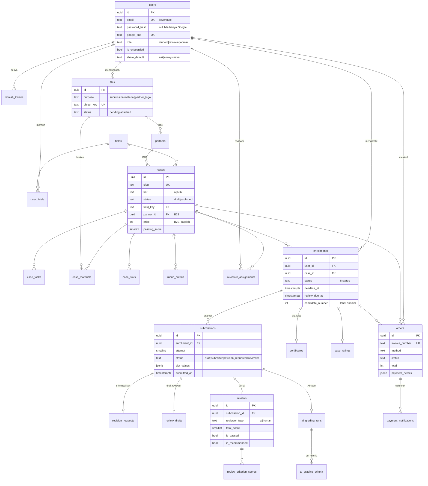

# Desain Database Simula

Skema awal (migrasi `001_initial_schema.sql`, 24 tabel), diturunkan dari kontrak client (`client/src/types/`), aturan bisnis di `prototype/CONTEXT.md`, dan kebutuhan AI Reviewer di `prototype/AI-CONTEXT.md`.

> Selama `001` belum dijalankan ke database bersama, file ini dan migrasinya masih boleh diubah langsung. Setelah dijalankan, perubahan wajib lewat migrasi baru.

## Konvensi

- Primary key `uuid DEFAULT gen_random_uuid()`, kecuali tabel referensi (`fields`), tabel relasi (PK gabungan), dan tabel 1:0..1 yang memakai FK induk sebagai PK.
- Waktu `timestamptz` (UTC). `created_at` dan `updated_at` diisi default `now()`; `updated_at` diperbarui GORM.
- Enum memakai `text` + `CHECK`, nilainya sama persis dengan union type di client.
- Daftar sederhana (paragraf konteks, skill, format berkas) memakai `jsonb` berisi array string.
- **NULL hanya dipakai bila "tidak ada" punya arti tersendiri**: belum terjadi (`submitted_at`, `paid_at`), tidak berlaku (`price` untuk AI case, `reviewer_id` untuk review AI), atau memang opsional dan client mengharapkan `null` (`major`, `linkedin_url`). Teks opsional yang kosongnya sama dengan "tidak ada" memakai `NOT NULL DEFAULT ''`.
- **Kelompok kolom yang hanya berlaku untuk sebagian baris dipisah ke tabel 1:0..1** (`revision_requests`, `review_drafts`), bukan kolom yang kosong di kebanyakan baris.
- Setiap tabel `ENABLE ROW LEVEL SECURITY` tanpa policy (menutup Data API Supabase).
- Uang dalam Rupiah (`integer`), skor 0–100 (`smallint`).

## Diagram

## Tabel

### Pengguna dan sesi

| Tabel | Isi | Catatan |
| --- | --- | --- |
| `fields` | Taksonomi bidang (12 baris, di-seed di migrasi) | Sama dengan `FIELD_OPTIONS` di client. Dirujuk FK dari `cases` dan `user_fields`. |
| `users` | Akun semua peran + data profil | Email lowercase dan unik. Minimal salah satu dari `password_hash` atau `google_sub` terisi. `is_active` untuk menonaktifkan akun tanpa menghapus riwayat. |
| `user_fields` | Bidang pilihan user (1–3) dengan urutan | Batas 3 dicek use case. |
| `refresh_tokens` | Hash refresh token, `family_id` untuk rantai rotasi, `revoked_at`, `replaced_by_id` | Token lama dipakai ulang → cabut seluruh `family_id`. |

### Berkas

| Tabel | Isi | Catatan |
| --- | --- | --- |
| `files` | Semua berkas di R2: pengunggah, `purpose`, `object_key`, nama asli, tipe, ukuran, `status` | Dibuat saat presign (`pending`), menjadi `attached` saat dipakai. Berkas `pending` lama dibersihkan task. Dirujuk dari `submissions.slot_values` (`fileId`), `case_materials.file_id`, dan `partners.logo_file_id`. |

### Case (dibuat admin)

| Tabel | Isi | Catatan |
| --- | --- | --- |
| `partners` | Mitra B2B: nama, industri, profil, logo | |
| `cases` | Info umum, info detail publik (`about`, `activities`, `skills`, `prerequisites`), brief (`context`), harga, mitra, `reviewer_role`, `passing_score`, `deadline_days` | AI case wajib tanpa harga, mitra, tenggat, dan `reviewer_role` (CHECK). Kelengkapan untuk terbit dicek use case. |
| `case_tasks` | Daftar tugas brief, berurutan | |
| `case_materials` | Nama dan keterangan materi pendukung + `file_id` | Format dan ukuran diambil dari `files`. |
| `case_slots` | Slot deliverable: `slot_key`, `kind`, wajib/opsional, format, ukuran, batas panjang teks | `kind`: `text`, `file`, `link`, `code` (zip). AI memakai `text`/`file`/`code`; B2B `file`/`link`. |
| `rubric_criteria` | Kriteria, bobot, deskripsi, `level_descriptions` (5 teks) | Total bobot 100 dicek use case. |
| `reviewer_assignments` | Reviewer yang ditugaskan per case B2B | Reviewer hanya bisa mengakses submission dari case di sini. |

### Pengerjaan dan penilaian

| Tabel | Isi | Catatan |
| --- | --- | --- |
| `enrollments` | Satu baris per user per case. Status, tenggat, `review_due_at`, `last_retried_at`, skor, `candidate_number`, `share_consent`, `retry_count`, `revision_count` | Coba lagi memakai baris yang sama. Order B2B gagal/kedaluwarsa menghapus enrollment `pending_payment`. |
| `submissions` | Satu baris = satu attempt, dari draft sampai diputuskan | Status `draft` → `submitted` → `revision_requested` atau `reviewed`. Maksimal satu `draft` dan satu `submitted` per enrollment (partial unique index). Selain draft, `submitted_at` dan centang "pekerjaan sendiri" wajib. |
| `revision_requests` | Keputusan reviewer mengembalikan submission: alasan, catatan, reviewer | PK = `submission_id`, jadi satu submission paling banyak dikembalikan sekali. |
| `review_drafts` | Isian form reviewer yang tersimpan otomatis (`decision`, `grade`, `revision`) | PK = `submission_id`. Dihapus di transaksi yang sama saat keputusan dikirim. |
| `reviews` | Hasil final dari AI atau reviewer manusia | Selalu lengkap. `passing_score` disalin saat dinilai. Review AI tanpa `reviewer_id`, review manusia wajib punya. Rekomendasi hanya bila lulus. |
| `review_criterion_scores` | Skor per kriteria: nama dan bobot disalin, level, alasan | Disalin supaya hasil lama tidak berubah bila rubrik diedit. |
| `ai_grading_runs` | Satu run penilaian AI per submission: status, model, waktu, error | Sumber `aiGrading` di halaman status. |
| `ai_grading_criteria` | Hasil LLM per kriteria: level, alasan, token, percobaan | `checkedCriteria` = jumlah baris `done`. |
| `certificates` | `public_id` acak untuk URL verifikasi + data penerima, case, mitra, skor yang disalin | Satu per enrollment. |
| `case_ratings` | Rating 1–5 dan komentar dari peserta yang sudah selesai | Sumber `rating` di katalog (rata-rata). |

### Pembayaran

| Tabel | Isi | Catatan |
| --- | --- | --- |
| `orders` | Invoice (`INV/YYYY/MM/NNNN` dari sequence), metode, status, subtotal + biaya admin = total, batas bayar, `payment_details` | `payment_details` berisi instruksi bayar sesuai metode: VA `{vaNumber}`, Mandiri `{billerCode, billKey}`, QRIS `{qrUrl}`, GoPay `{deeplinkUrl, qrUrl}`. Maksimal satu order `awaiting_payment` per user per case. |
| `payment_notifications` | Log mentah webhook Midtrans | Untuk audit dan idempotensi. |

## Timeline status (tanpa tabel event)

Halaman status menampilkan riwayat `paid`, `started`, `submitted`, `revision_requested`, `reviewed`, `retried`. Riwayat ini disusun lewat satu query `UNION ALL` dari data yang sudah ada, sehingga tidak bisa tidak sinkron:

| Event | Sumber |
| --- | --- |
| `paid` | `orders.paid_at` |
| `started` | `enrollments.started_at` |
| `retried` | `enrollments.last_retried_at` (B2B paling banyak sekali) |
| `submitted` #n | `submissions.submitted_at` |
| `revision_requested` | `revision_requests.created_at` |
| `reviewed` | `reviews.reviewed_at` |

## Aturan yang ditegakkan database

- `UNIQUE`: email user, `google_sub`, slug case, nama mitra, `object_key` berkas, `(user_id, case_id)` enrollment, `(case_id, candidate_number)`, `(enrollment_id, attempt)` submission, `invoice_number`, `public_id` sertifikat.
- Partial unique: satu draft dan satu submission `submitted` per enrollment, satu order `awaiting_payment` per user per case.
- `CHECK` untuk semua enum, rentang skor (0–100), level (1–5), bobot (1–100), harga positif, `total = subtotal + admin_fee`, AI case tanpa data komersial, kelengkapan submission yang sudah dikirim.
- Foreign key: data turunan case dan submission ikut terhapus (`CASCADE`); user, case, berkas, dan order yang sudah dipakai tidak bisa dihapus.

Aturan yang dicek **use case**: total bobot rubrik 100, kelengkapan case sebelum terbit, maksimal 3 bidang, batas revisi 2 kali, transisi status enrollment dan submission.

## Keputusan

| Topik | Keputusan |
| --- | --- |
| Notifikasi | Hanya email, selalu dikirim (semua event bersifat transaksional). Tidak ada notifikasi in-app maupun pengaturan notifikasi. |
| Timeline status | Disusun lewat query, tanpa tabel event. |
| Draft submission | Satu tabel dengan submission (`status = 'draft'`), karena kolomnya sama. |
| Revisi dan draft review | Tabel 1:0..1 terpisah, karena kolomnya hanya berlaku untuk sebagian submission. |
| Rating case | Tabel `case_ratings`, diisi peserta setelah melihat hasil; katalog memakai rata-rata. |
| Deliverable di halaman detail | Diambil dari judul dan deskripsi `case_slots`, tidak disimpan terpisah. |
| Info detail dan logo mitra | Ada di skema; form pembuat case di client perlu ditambah isiannya. |
| Jenis slot `code` | Ditambahkan untuk zip kode AI case; tipe slot di client perlu ditambah. |
| Status order `cancelled` | Untuk order yang dibatalkan saat ganti metode; endpoint checkout tidak mengembalikannya. |
| Jumlah peserta | Dihitung dari `enrollments` saat query; kolom ringkasan menyusul bila lambat. |

## Dampak ke client

- Hapus pengaturan notifikasi di Profil, `PUT /users/me/notifications`, dan tipe `TNotificationPreferences`.
- Tambah `code` ke `TSlotKind`.
- Tambah isian info detail (`about`, `activities`, `skills`, `prerequisites`) dan logo mitra di pembuat case.
- Instruksi bayar Midtrans (`billerCode`, `billKey`, `qrUrl`, `deeplinkUrl`) di `IOrder`.
- Fitur memberi rating case (endpoint dan UI) bila `rating` tetap ditampilkan.
